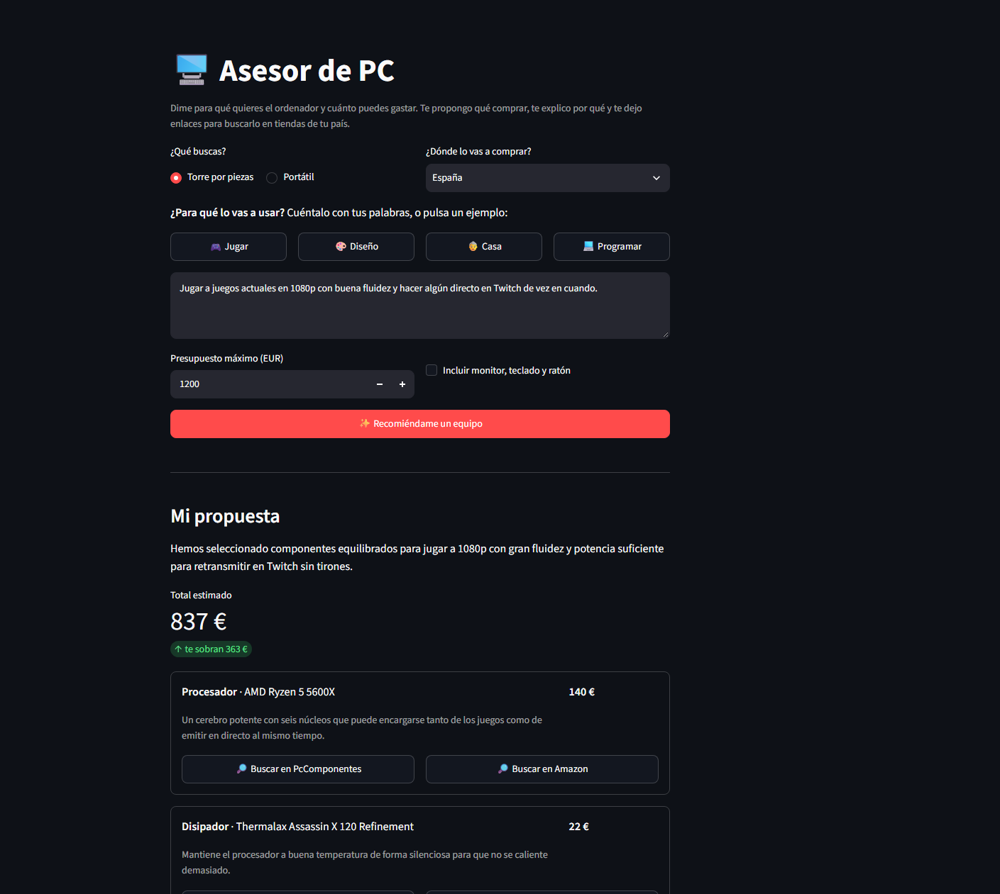
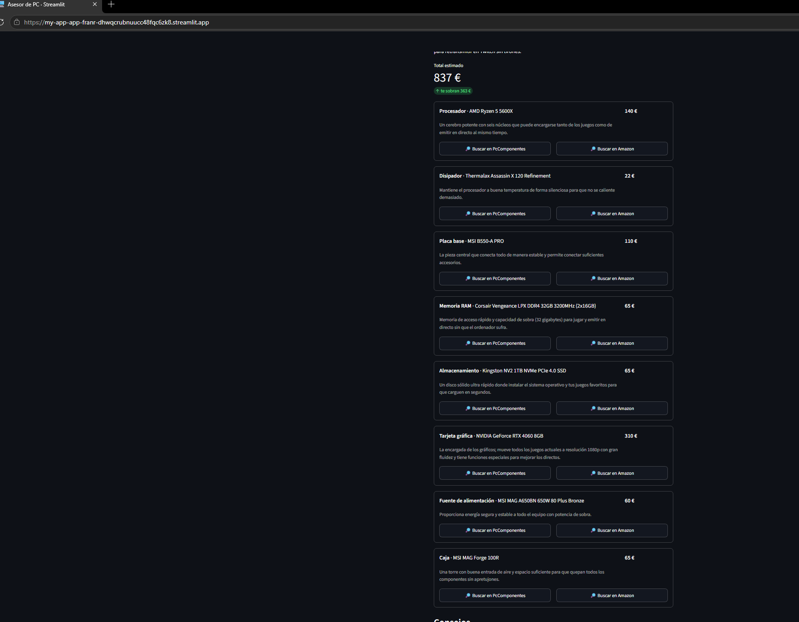
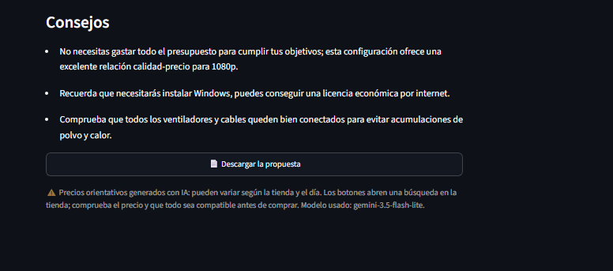
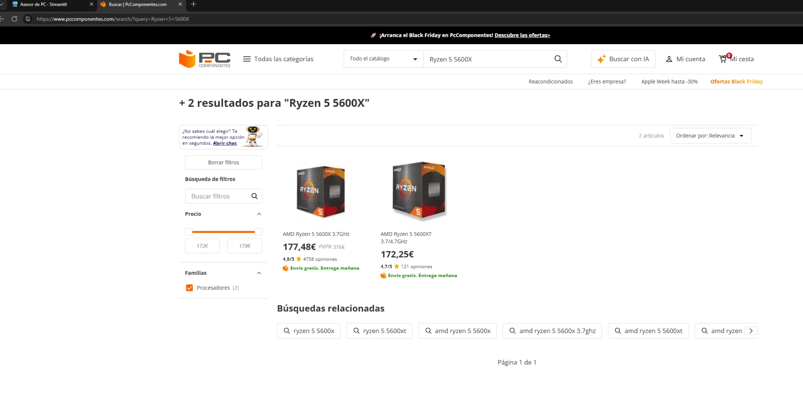
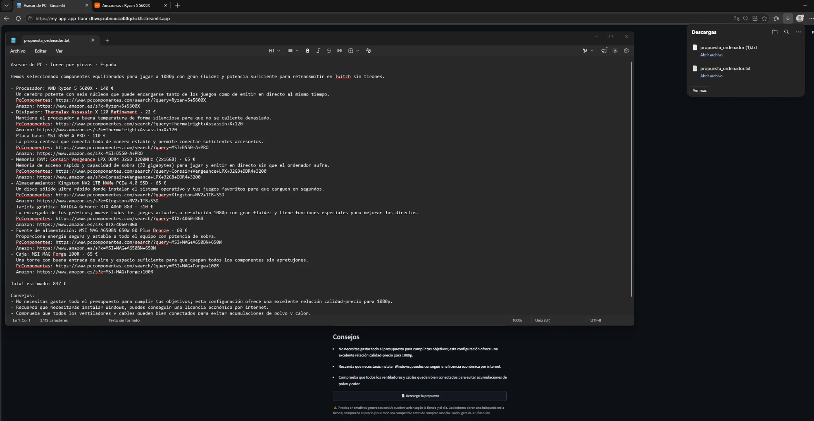
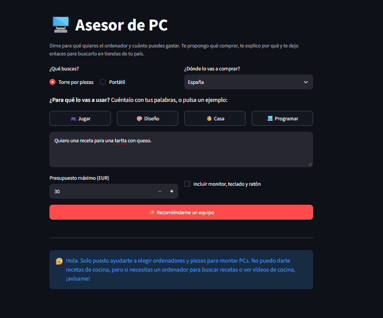
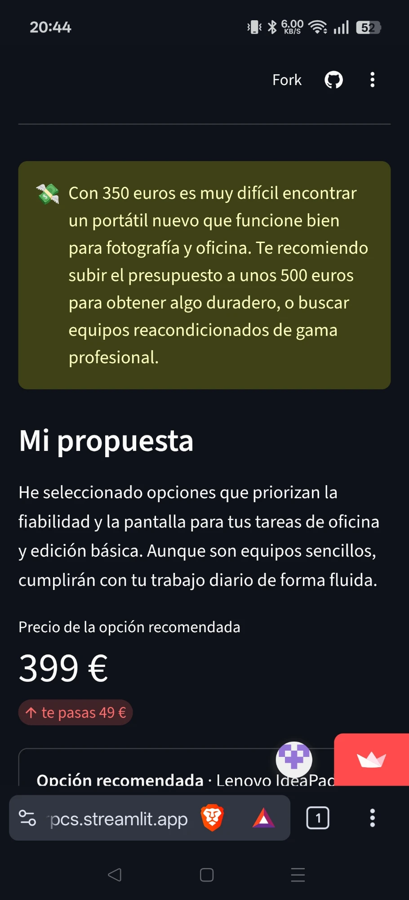
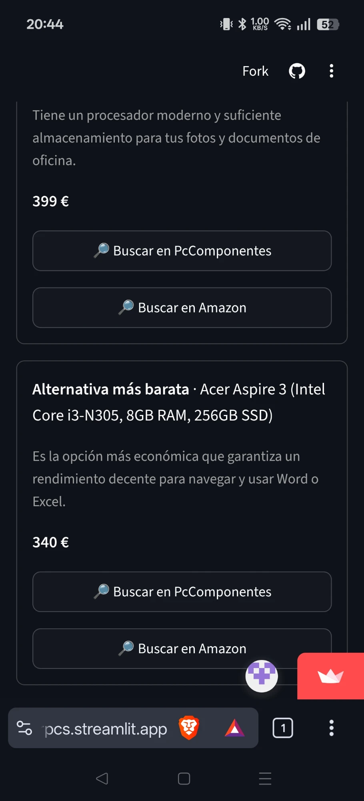
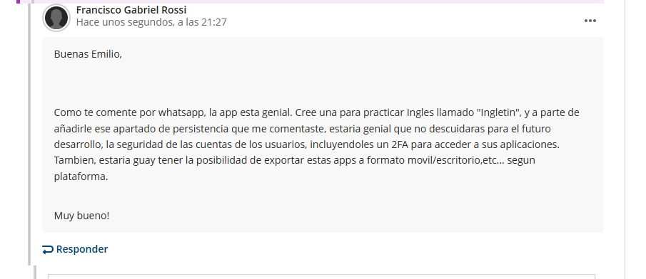

# 🖥️ AsesorPCs

> *"Quiero un ordenador para editar vídeos y jugar algo, tengo 900 €. ¿Qué me compro?"*
> AsesorPCs contesta a esa pregunta en unos segundos, en tu idioma y con enlaces a tiendas de tu país.

| | |
|---|---|
| 🌐 **Pruébala** | https://asesorpcs.streamlit.app/ |
| 👤 **Autor** | Francisco Gabriel Rossi |
| 🎓 **Contexto** | Reto del módulo *Python para IA*, Máster en Inteligencia Artificial (OBS Business School) |
| 🧰 **Stack** | Python · Streamlit Community Cloud · API de Gemini (`google-genai`) · pydantic · fpdf2 · openpyxl |

---

## En cinco frases

1. Quien no entiende de informática y necesita un ordenador depende del amigo "que sabe", de foros llenos de siglas o del dependiente de turno, y suele acabar pagando de más o quedándose corto.
2. AsesorPCs le pregunta para qué lo quiere, cuánto puede gastar y en qué país lo comprará, y le devuelve una torre pieza a pieza o dos o tres portátiles, con el motivo de cada elección y botones para buscarlos en tiendas locales.
3. La IA hace lo que ningún filtro de tienda puede hacer: convierte una frase como "quiero mover modelos de IA en local" en una configuración compatible y ajustada al presupuesto (en ese caso, priorizando una gráfica con 16 GB de VRAM), explicada sin jerga.
4. Marc, un compañero de trabajo, la usó desde el móvil para elegir un portátil de oficina y le sirvió para orientarse, pero en la tienda el precio era bastante más alto que el de la app. Al comparar con PcComponentes vi que la IA se quedaba entre un 25 % y un 50 % por debajo, así que calibré el prompt con precios reales y añadí un rango ("habitual – máximo"): ahora el desfase es de entre un 0 % y un 10 %.
5. Lo siguiente sería leer el precio real de cada tienda en el momento (con sus APIs de afiliados o la búsqueda de Google de Gemini, que no entra en la capa gratuita) y añadir un botón para compartir la propuesta por WhatsApp o correo, que fue la otra petición de Marc. El precio en vivo marca la diferencia: el Ryzen 5 5600X que la IA estimó en 140 € costaba ese día 177,48 €.

---

## ¿Para quién es?

Pienso en tres personas: el estudiante de diseño que necesita un equipo para Blender y no sabe si "RTX" es importante, la familia que compra un portátil para la abuela, y quien quiere empezar a ejecutar LLM en su casa y no sabe que lo que manda es la VRAM. Hoy lo resuelven preguntando a alguien, viendo vídeos de una hora o fiándose de la etiqueta de "oferta". Es una compra cara que dura años, así que equivocarse sale caro.

**Qué resuelve la IA:** traducir una necesidad contada con palabras normales en piezas concretas, compatibles entre sí (socket, tipo de RAM, potencia de la fuente) y dentro del presupuesto, y explicarlo como lo haría un amigo paciente.

**Qué queda fuera, a propósito:** los precios en tiempo real y el stock (los precios son orientativos, calibrados con precios reales y mostrados como rango), la compra y el montaje. Los enlaces son búsquedas en tiendas reales, no fichas de producto.

## Cómo se usa

1. Elige **torre por piezas**, **torre ya montada** (lista para enchufar) o **portátil**, y el **país** (España, México, Argentina, Colombia, Chile, Perú o EE. UU.).
2. Cuenta **para qué lo quieres** o pulsa uno de los seis ejemplos: 🎮 Jugar · 🎨 Diseño · 👵 Casa · 💼 Oficina · 💻 Programar · 🤖 IA local.
3. Pon tu **presupuesto** en tu moneda. Si es una torre, marca si quieres monitor, teclado y ratón, y en cualquier caso si quieres **añadir una licencia de Windows 11 Pro**: la app propone una licencia legal de tienda oficial dentro del presupuesto, y si el equipo ya trae Windows te lo dice y no la suma.
4. Pulsa **✨ Recomiéndame un equipo**. Recibes cada pieza con su porqué y un rango de precio (el habitual y el máximo que puedes encontrar), el total frente a tu presupuesto, avisos (si no llega o si sobra) y consejos.
5. Cada producto tiene botones **🔎 Buscar en [tienda]**, y toda la propuesta se puede **descargar en PDF o en Excel**, con los enlaces clicables.

## Decisiones de diseño (y por qué)

**Gemini con salida estructurada.** Necesitaba entender lenguaje natural y razonar sobre compatibilidad y presupuesto, que es terreno de un LLM. Un clasificador de Hugging Face no basta y un RAG no tiene sentido porque no hay documentos propios. Pido la respuesta como JSON validado con pydantic (`response_schema`), así la app pinta tarjetas en vez de un muro de texto.

**La IA no escribe enlaces.** Si se le piden URLs, se las inventa. Por eso Gemini solo devuelve el texto de búsqueda ("Ryzen 5 7600") y es el código el que construye la búsqueda en PcComponentes, Amazon, Mercado Libre, Newegg o Google Shopping, según el país.

**Elección de modelo con datos, no a ojo.** Medido con mi clave gratuita el 04/11/2026, con la misma consulta (torre para jugar, 1200 €):

| Modelo | Tiempo | ¿Aprovecha el presupuesto? | Notas |
|---|---|---|---|
| `gemini-3.8-flash` (el de las plantillas) | 1-68 s | — | Error 503 "alta demanda" en todos los intentos |
| `gemini-3.7-flash` | 5 s | — | Error 503 |
| **`gemini-3.5-flash`** (razonamiento bajo) | **~6 s** | **Sí: 1158-1200 €** | **Elegido como principal** |
| `gemini-3.1-flash-lite` | ~5 s | Sí: 1150 € | Primera reserva |
| `gemini-3.5-flash-lite` | ~14 s | Desigual: 837-1180 € | Segunda reserva |

**Precios: la parte más difícil.** Un LLM no sabe el precio de hoy. La búsqueda de Google integrada en Gemini (*grounding*) lo resolvería, pero con la clave gratuita devuelve 429: no entra en la capa gratuita y el reto exige coste cero. Por eso medí el desfase y lo corregí en el prompt con ejemplos reales, pedí la configuración exacta de cada portátil (con el mismo nombre comercial, el IdeaPad Slim 3 va de unos 500 € a 830 € según la configuración) y añadí un precio máximo para mostrar un rango. Comparado con PcComponentes el 04/11/2026:

| Producto propuesto | Antes de calibrar | Después de calibrar | PcComponentes |
|---|---|---|---|
| IdeaPad Slim 3 15AMN8 Ryzen 3 8GB | 329 € | — | 497-499 € |
| IdeaPad Slim 3 i5 16GB 512GB | 549 € | 579-649 € | 639-699 € |
| Vivobook 15 i5 16GB 512GB | — | 649-720 € | 649-685 € |
| MacBook Air M2 8GB 256GB | — | 929-999 € | 939 € |

**Windows, legal o nada.** Cuando se pide la licencia, el prompt solo permite licencias OEM o retail vendidas por Microsoft o por la propia tienda (en España, unos 145 €), explica por qué las claves de 5-20 € de webs de reventa pueden desactivarse, y la cuenta dentro del presupuesto. Si el portátil o la torre montada ya trae Windows, no se suma y se avisa en los consejos.

**Exportar no gasta IA.** El PDF (fpdf2) y el Excel (openpyxl) se generan en el código a partir de la respuesta que ya se tiene, así que no hacen ninguna llamada a Gemini ni consumen cuota.

**Si algo falla, la app sigue en pie.** Prueba los modelos en orden y salta al siguiente ante un 429 (cuota), un 5xx (saturación), un 404 (modelo retirado) o si pasan 30 s. Si fallan todos, muestra un mensaje en lenguaje normal ("se ha agotado el uso gratuito, espera un minuto") y deja el detalle técnico en un desplegable. Las respuestas se guardan una hora en caché para no gastar cuota con consultas repetidas.

**La clave nunca toca el repositorio.** Está en *Settings → Secrets* de Streamlit Cloud y en un `.streamlit/secrets.toml` local que está en `.gitignore`. Antes de cada push se comprueba automáticamente que la clave no aparece en ningún archivo del commit.

## Cómo la construí

La programé conversando con **Claude Code** (agente de programación) desde la app de escritorio, sin Colab. El agente lee [AGENTS.md](AGENTS.md) (a través de [CLAUDE.md](CLAUDE.md)), y la especificación completa está en [especificacion.md](especificacion.md).

**Los prompts que marcaron el rumbo** (copiados tal cual):

1. Elegir la idea:
   > *"Necesito que me des ideas de que hacer, en un programa en python con IA (con key de gemini para usar en streamlit mejor) […] una app que genere presupuestos de componentes para un ordenador de torre, o incluso portatiles […] y si es posible, con enlaces de compra disponibles en su region […] Otra idea es, una app para entrenamiento […] da tu criterio de cual seria mejor, para ejecutar y ACABAR en este ultimo dia"*
2. Construir sin Colab:
   > *"No quiero usar colab para crear el codigo, lo quiero hacer contigo, pero si quiero usar una key de gemini con un modelo gratuito en caso de, para no gastar contigo."*
3. Desplegar:
   > *"He pegado la clave en el archivo que has dicho y tambien en streamlit, que he vinculado la repo de la cuenta de github […] machaca todo lo que quieras dentro, y asi podre probar la app en streamlit"*
4. Mejorar tras la prueba:
   > *"Va bien aunque creo que tardo bastante en hacermela esta primera […] quizas habra que poner un modelo un poco mas rapido, pero sin que gaste mucho […] añadir […] un boton mas donde se evalue un presupuesto para gente que quiera un equipo para mover agentes LLM locales de IA"*
5. Corregir lo que vio Marc:
   > *"Ha tenido que volver a hacer la peticion debido a que la primera vez, se invento bastante el precio recomendado, donde luego en la opcion de compra, era un precio bastante mas caro, habria que precisar un poco mas esto […] estaria genial que se pudiera exportar en vez de a txt, a pdf o excel […] una opcion(boton) para compartir por whatsapp, correo, etc... Esto ultimo lo podemos dejar como mejora"*

**Qué delegué y qué decidí o revisé yo:**

| Delegado al agente | Revisado o decidido por mí |
|---|---|
| Comparar las dos ideas (presupuestos de PC frente a rutinas de ejercicio) | Elegí la de PC: la de ejercicio necesitaba login y base de datos y manejaba datos de salud, y no se acababa en un día |
| Escribir `app.py`, el esquema JSON y el manejo de errores | Probé la app desplegada como usuario: caso normal, fuera de tema, enlaces y descarga |
| Generar los enlaces por código en lugar de pedírselos a la IA | Comprobé que las búsquedas de PcComponentes y Amazon.es abren el producto correcto (capturas 4) |
| Pruebas automáticas con Gemini simulado (429, campo vacío, falta de clave) | Detecté la lentitud de la primera consulta y pedí un modelo más rápido sin gastar |
| Medir los modelos y montar la cadena de reserva con límite de tiempo | Pedí el ejemplo 🤖 IA local y revisé que la propuesta prioriza la VRAM |
| Comprobar si la búsqueda de Google de Gemini entra gratis (no entra), medir el desfase de precios y calibrar el prompt | Recogí el feedback de Marc y decidí qué entraba hoy (precios y PDF/Excel) y qué quedaba como mejora (compartir) |
| Borradores de especificación, AGENTS.md y README | Cambié el nombre del repositorio y ajusté el texto final |

Un tropiezo real del proceso: la app desplegada se quedaba cargando en Brave, Edge y LibreWolf. El servidor estaba bien (comprobado por el agente) y la causa era mi DNS, Quad9, que bloqueaba parte de la conexión con Streamlit. Al cambiar de DNS cargó a la primera.

## Prueba y mejora

| Quién | Qué probó | Qué pasó | Qué cambió |
|---|---|---|---|
| Yo, con el agente, en local | Torre para jugar y hacer directos, 900 €, España | Piezas compatibles, pero solo 665 €: le sobraban 235 € que podían ir a la gráfica | Nueva regla en el prompt: aprovechar el 85-100 % del presupuesto cuando mejora el uso. Corregí también el formato de los precios en México (18,000) |
| Yo, con el agente, en local | 4K a tope por 300 € y "receta de paella" | Avisa de que hacen falta unos 2.000 € y propone lo mejor posible; la paella la rechaza con amabilidad | Nada, cumple la especificación |
| Yo, en la app desplegada | Torre para jugar, 1200 €, España; enlaces; descarga; "receta de tarta de queso" | La primera respuesta tardó mucho y la dio el modelo de reserva (837 €, sobraban 363 €). Enlaces y descarga correctos; tarta rechazada | Medí 5 modelos y cambié el principal a `gemini-3.5-flash` con límite de 30 s y dos reservas: 4-7 s y 1158 € de 1200 €. Añadí el ejemplo 🤖 IA local |
| Yo, con el agente | 🤖 IA local: torre de 1500 € (España) y portátil de 30.000 MXN | Torre con RTX 4070 Ti SUPER de 16 GB, 32 GB de DDR5 y la nota "modelos de 7B y 14B cuantizados a 4 bits"; portátil con RTX 4070 | — |
| Yo, con el agente | Nuevo ejemplo 💼 Oficina: portátil de 700 € y torre de 1200 € (España) | Portátiles con 16 GB de RAM y sin gráfica dedicada (550 €, alternativas de 480 € y 650 €). En la torre avisa de que 1200 € es demasiado para ofimática y se queda en 960 € con piezas silenciosas | Regla del prompt para ofimática: gráficos integrados, 16 GB, SSD, batería y cámara; no gastar por gastar. Los 6 ejemplos van ahora en dos filas de 3 para que se lean bien |
| **Marc, compañero de trabajo** (desde el móvil) | Portátil para la oficina: Office, fotografía básica e internet, 350 € | Le sirvió para orientarse y quizá compre la opción recomendada. El aviso de presupuesto justo le resultó útil (capturas 7 y 8). Pero el primer precio era bastante más bajo que el de la tienda y tuvo que repetir la consulta. Pidió exportar a PDF o Excel y compartir por WhatsApp o correo | Precios calibrados con datos reales, configuración exacta en cada portátil y rango "habitual – máximo". Exportación a PDF y Excel con enlaces. Compartir queda como siguiente mejora |
| Yo, con el agente | La misma petición de Marc con 600 € y 900 €, comparando con PcComponentes | Antes de calibrar: un 25-50 % por debajo del precio real. Después: MacBook Air M2 estimado en 929-999 € (real 939 €), Vivobook en 649-720 € (real 649-685 €) | — |
| Yo, con el agente | Nuevas opciones: torre ya montada para jugar (1000 €), torre por piezas de oficina (700 €) y portátil de oficina (700 €), todas con licencia de Windows 11 Pro | Torre montada: tres equipos premontados y licencia OEM de 145 €. Portátil: detecta que trae Windows 11 Home, no suma licencia y lo avisa. Torre por piezas: la licencia hacía pasar el total a 795 € | Regla del prompt: la licencia cuenta dentro del presupuesto. Ahora el total queda en 615 € de 700 € |
| Yo, en la app desplegada | Torre ya montada para jugar, con la licencia marcada | El modelo no sabía si el equipo traía Windows, no sumó licencia y solo dijo "revisa si lo incluye" | El nombre de cada equipo indica ahora "Windows 11" o "sin sistema operativo"; si duda, suma la licencia. Si no la suma, la app avisa de que el equipo ya trae Windows |

### Mi feedback a un compañero

Probé **Ingletin**, una app para practicar inglés de [YAHORAQUE](https://github.com/eampudia/yahoraque), el proyecto de un compañero del máster que reúne apps para gente sin conocimientos técnicos (captura 9). Le dejé esto en el debate del hito:

> *"Buenas Emilio, Como te comente por whatsapp, la app esta genial. Cree una para practicar Ingles llamado "Ingletin", y a parte de añadirle ese apartado de persistencia que me comentaste, estaria genial que no descuidaras para el futuro desarrollo, la seguridad de las cuentas de los usuarios, incluyendoles un 2FA para acceder a sus aplicaciones. Tambien, estaria guay tener la posibilidad de exportar estas apps a formato movil/escritorio,etc... segun plataforma. Muy bueno!"*

## Próximos pasos

- **Compartir la propuesta** por WhatsApp, correo o enlace (petición de Marc).
- **Precio real en el momento**, con las APIs de afiliados de las tiendas o con la búsqueda de Google de Gemini en una clave de pago.
- **Ajustar conversando**: "cámbiame la gráfica por una más barata" sin rehacer toda la propuesta.

## Capturas

| | |
|---|---|
|  **1.** La app funcionando: propuesta y total frente al presupuesto |  **2.** Cada pieza con su porqué y sus botones de búsqueda |
|  **3.** Consejos y modelo que respondió (aquí, el de reserva) |  **4.** El botón abre la búsqueda real en PcComponentes |
|  **5.** Primera versión de la descarga (.txt); ahora es PDF y Excel |  **6.** Caso límite: una receta de tarta de queso, rechazada con amabilidad |
|  **7.** La prueba de Marc en el móvil: avisa de que 350 € es justo |  **8.** Las opciones que recibió, con sus botones de búsqueda |
|  **9.** Mi feedback a la app de un compañero en el debate del hito | |

## Ejecutarla en tu ordenador

```bash
pip install -r requirements.txt
cp .streamlit/secrets.toml.example .streamlit/secrets.toml   # y pon tu GEMINI_API_KEY
streamlit run app.py
```

La clave se crea gratis en [AI Studio](https://aistudio.google.com/apikey). No hace falta tarjeta.
